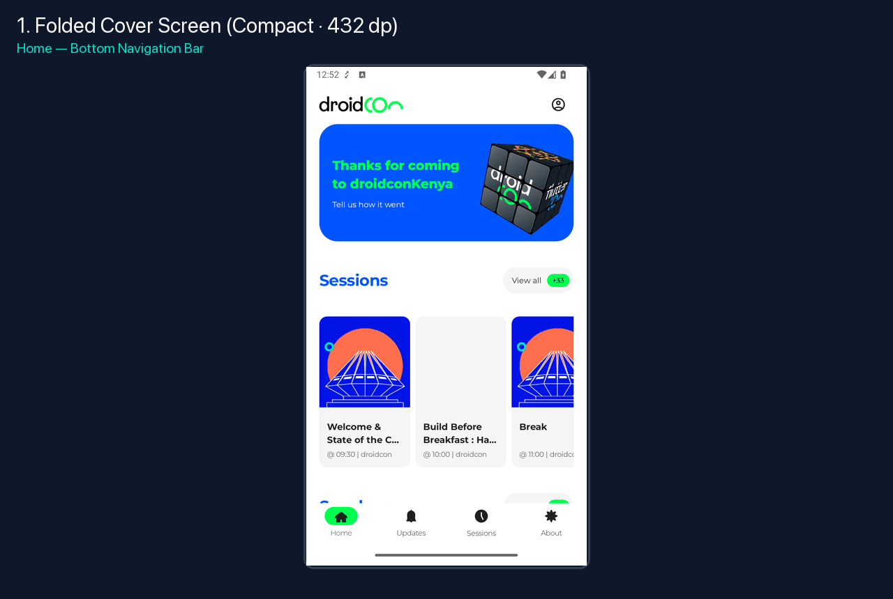
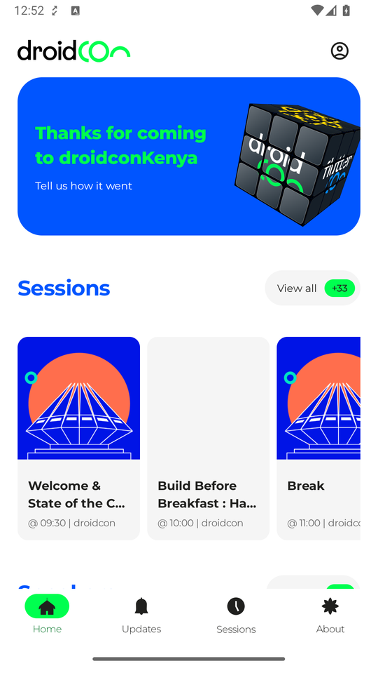
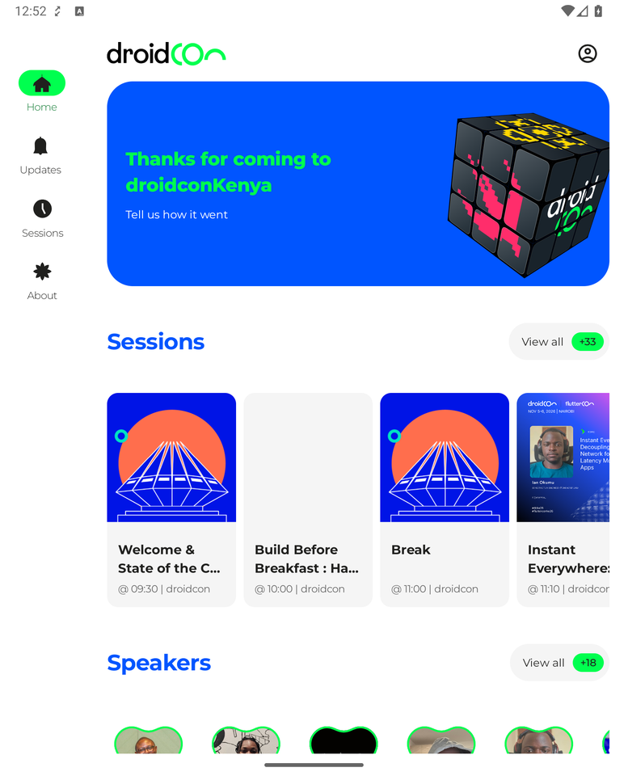
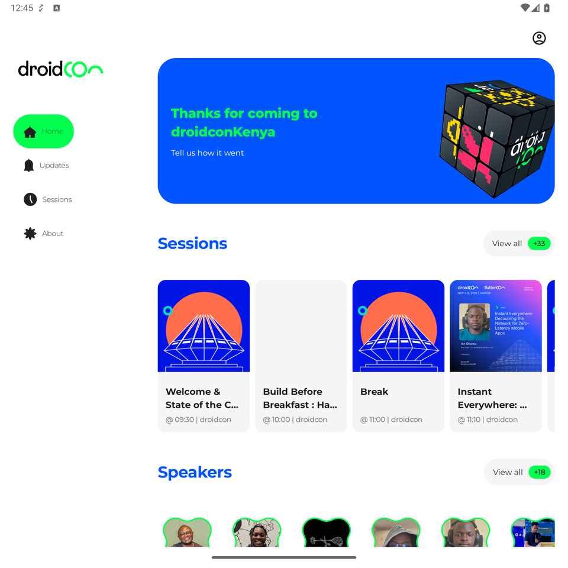
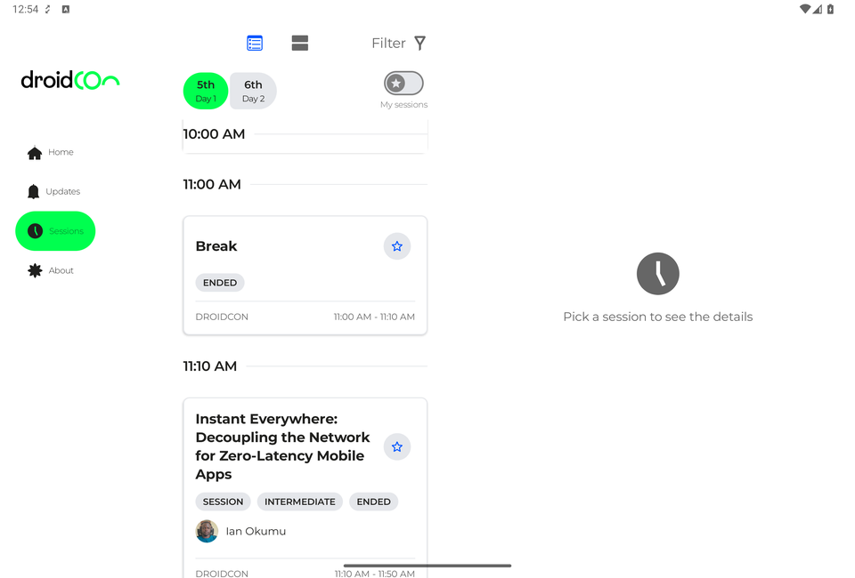
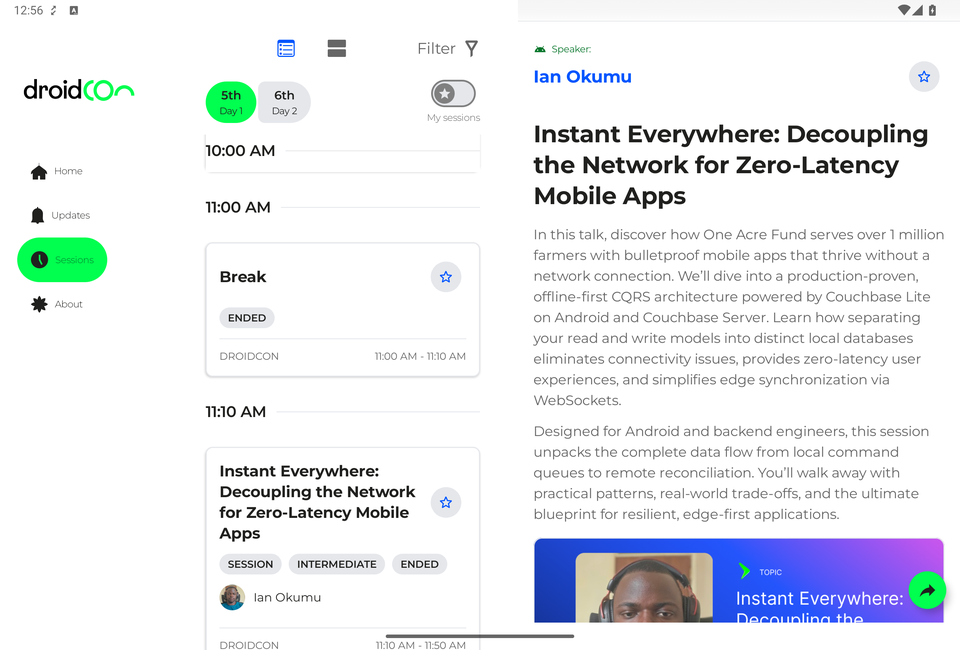

# Adaptive & foldable layouts

The app adapts continuously to the current window size and device hinge posture using Material 3
Adaptive (`NavigationSuiteScaffold`), Navigation 3 multi-pane scenes (`ListDetailSceneStrategy`),
and Compose 1.13 `mediaQuery { windowPosture.isTabletop }`.

## Breakpoints and postures

| State | Window | Size class | Navigation chrome | Layout strategy | Detail back arrow |
| --- | --- | --- | --- | --- | --- |
| **Folded cover screen** | `432×768 dp` | Compact (`< 600 dp`) | Bottom navigation bar (hidden on detail) | Single-pane full screen | Shown |
| **Medium / portrait unfold** | `681×841 dp` | Medium (`600–839 dp`) | Collapsed rail (`WideNavigationRailCollapsed`) | Single-pane beside rail | Shown |
| **Unfolded 1:1 inner screen** | `864×864 dp` | Expanded (`content < 840 dp`) | Expanded drawer (`WideNavigationRailExpanded`, logo in header) | Single-pane beside drawer (drawer stays visible on detail) | Shown |
| **Wide unfolded / tablet** | `1120×759 dp` | Expanded (`content ≥ 840 dp`) | Expanded drawer | Navigation 3 `ListDetailSceneStrategy` (list + detail side-by-side) | Hidden (`StatusBarProtection` active) |
| **Half-open tabletop** | Pixel Fold `HALF_OPENED` (horizontal hinge) | Tabletop | Hidden on detail | `TabletopBody` with `windowToLocal` hinge bounds: banner above crease, scrollable controls below | Shown |

## State gallery

### 1. Folded cover screen (Compact)

<table>
  <tr>
    <td align="center" width="50%">
       
      <b>Home</b> — bottom bar + top-bar brand logo
    </td>
    <td align="center" width="50%">
       
      <b>Session details</b> — bottom bar hidden, full-height scroll
    </td>
  </tr>
</table>

### 2. Medium rail & 1:1 unfolded drawer

<table>
  <tr>
    <td align="center" width="50%">
       
      <b>Medium (`681 dp`)</b> — collapsed navigation rail along the start edge
    </td>
    <td align="center" width="50%">
       
      <b>Unfolded 1:1 (`864 dp`)</b> — expanded drawer owns the brand logo
    </td>
  </tr>
</table>

### 3. Wide unfolded / tablet two-pane List-Detail (Navigation 3)

<table>
  <tr>
    <td align="center" width="50%">
       
      <b>Placeholder</b> — sessions list + detail empty prompt
    </td>
    <td align="center" width="50%">
       
      <b>List + detail</b> — inline detail pane, no redundant back arrow
    </td>
  </tr>
</table>

### 4. Half-open tabletop posture (Pixel Fold `HALF_OPENED`)

   
  <b>Tabletop</b> — session banner cleanly constrained above the horizontal hinge; speaker, bookmark, description, and share FAB below it

